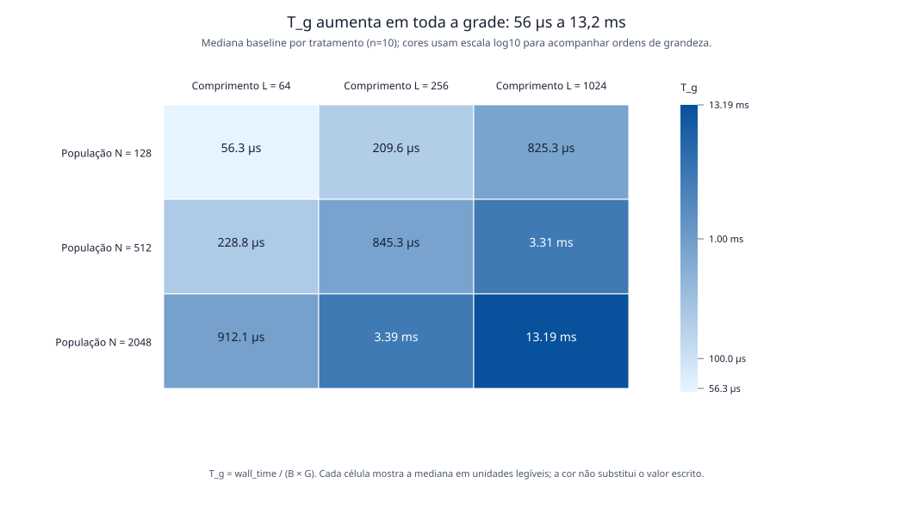
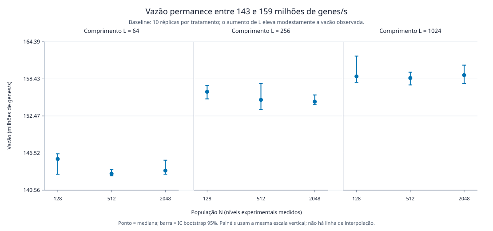
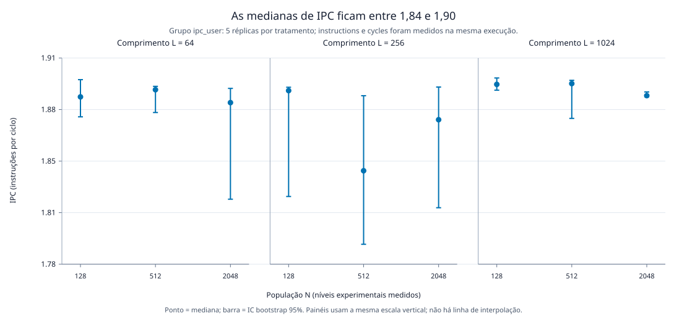
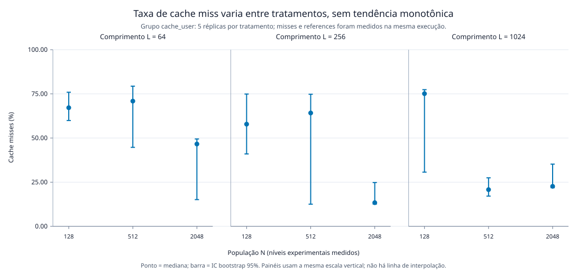
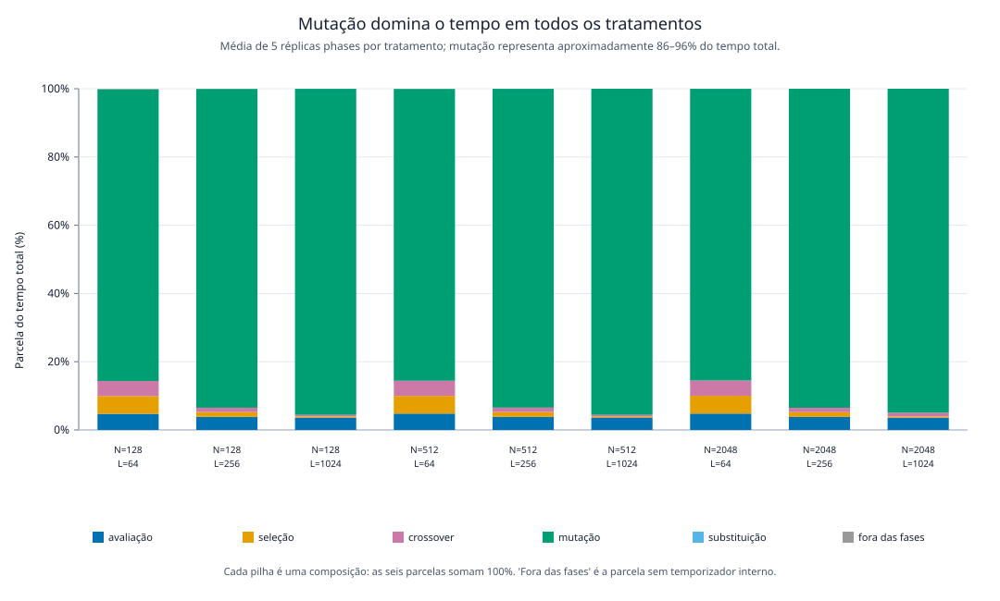
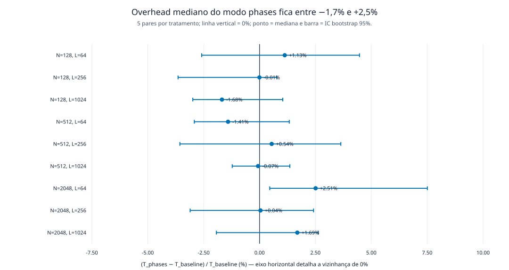
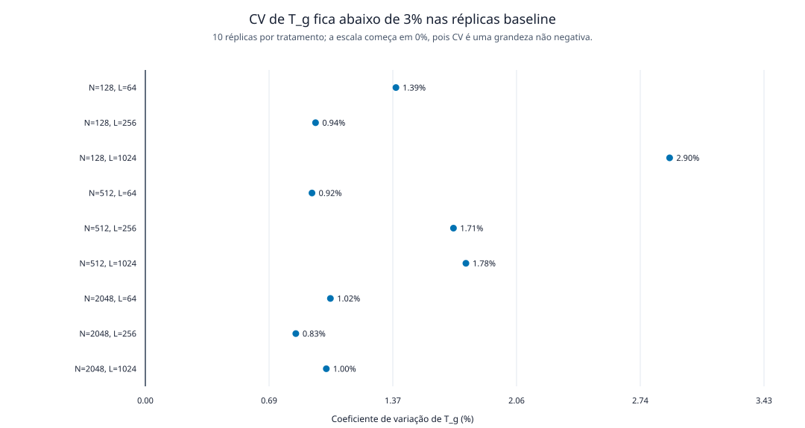

## Pergunta, dados e regras de qualidade

Este caderno responde à pergunta: como o tamanho da população (`N`) e o
comprimento do cromossomo (`L`) alteram o custo computacional do algoritmo
genético sequencial OneMax? O objeto é custo, não qualidade de otimização; por
isso cada execução mantém `G=100` gerações e os lotes `B` definidos por
tratamento. A unidade de trabalho é `B × N × L × G` genes processados.

O alvo `make analyse` começa por `scripts/validate_data.py`. Ele aceita apenas
linhas completas, com afinidade observada no CPU configurado, parâmetros iguais
ao DOE que estava congelado em cada campanha e, em `perf`, todos os contadores
ativos por 100% do intervalo. Linhas inválidas continuam preservadas em
`data/raw/`, mas não são silenciosamente incluídas aqui. Pontos extremos são
sinalizados abaixo e não são removidos automaticamente.

## Programa reprodutível

O bloco a seguir é todo o programa da análise: lê exclusivamente os CSVs
validados, calcula respostas e intervalos bootstrap, grava sumários derivados,
desenha figuras SVG e produz o trecho Markdown incluído mais abaixo. Ele usa
apenas a biblioteca padrão do Python 3.12 para não depender de pacotes não
registrados no computador que mediu a campanha.

```{python}
#| code-fold: true
#| code-summary: "Mostrar o programa que gera tabelas e figuras"
from __future__ import annotations

import csv
import html
import math
import random
import statistics
from collections import defaultdict
from pathlib import Path


ROOT = Path.cwd()
if not (ROOT / "config" / "experiment.yaml").is_file():
    raise RuntimeError("execute o caderno a partir da raiz do repositório")

PROCESSED = ROOT / "data" / "processed"
FIGURES = ROOT / "figures"
MEASUREMENTS_PATH = PROCESSED / "measurements.csv"
ENVIRONMENT_PATH = PROCESSED / "environment.csv"
REPORT_PATH = PROCESSED / "analysis-report.md"
FIGURES.mkdir(parents=True, exist_ok=True)


def read_csv(path: Path) -> list[dict[str, str]]:
    with path.open(encoding="utf-8", newline="") as stream:
        return list(csv.DictReader(stream))


def write_csv(path: Path, fields: list[str], rows: list[dict[str, object]]) -> None:
    with path.open("w", encoding="utf-8", newline="") as stream:
        writer = csv.DictWriter(stream, fieldnames=fields, lineterminator="\n")
        writer.writeheader()
        writer.writerows(rows)


def as_int(row: dict[str, str], field: str) -> int:
    return int(row[field])


def as_float(row: dict[str, str], field: str) -> float:
    return float(row[field])


def median(values: list[float]) -> float:
    return float(statistics.median(values))


def stdev(values: list[float]) -> float:
    return float(statistics.stdev(values)) if len(values) > 1 else 0.0


def percentile(values: list[float], probability: float) -> float:
    ordered = sorted(values)
    if not ordered:
        raise ValueError("percentil sem observações")
    position = (len(ordered) - 1) * probability
    low = math.floor(position)
    high = math.ceil(position)
    if low == high:
        return ordered[low]
    return ordered[low] + (ordered[high] - ordered[low]) * (position - low)


def bootstrap_median_ci(values: list[float], seed: int, samples: int = 5000) -> tuple[float, float]:
    generator = random.Random(seed)
    medians = [median([generator.choice(values) for _ in values]) for _ in range(samples)]
    return percentile(medians, 0.025), percentile(medians, 0.975)


def describe(values: list[float], seed: int) -> dict[str, float | int]:
    mean = statistics.fmean(values)
    low, high = bootstrap_median_ci(values, seed)
    return {
        "n": len(values),
        "median": median(values),
        "mean": mean,
        "stddev": stdev(values),
        "cv_percent": (stdev(values) / mean * 100.0) if mean else float("nan"),
        "ci_low": low,
        "ci_high": high,
    }


def by_treatment(rows: list[dict[str, str]]) -> dict[tuple[int, int], list[dict[str, str]]]:
    grouped: dict[tuple[int, int], list[dict[str, str]]] = defaultdict(list)
    for row in rows:
        grouped[(as_int(row, "N"), as_int(row, "L"))].append(row)
    return dict(sorted(grouped.items()))


def work(row: dict[str, str]) -> int:
    return as_int(row, "batch") * as_int(row, "N") * as_int(row, "L") * as_int(row, "G")


def time_per_generation_ns(row: dict[str, str]) -> float:
    return as_int(row, "wall_time_ns") / (as_int(row, "batch") * as_int(row, "G"))


def throughput_genes_per_second(row: dict[str, str]) -> float:
    return work(row) * 1_000_000_000.0 / as_int(row, "wall_time_ns")


def fmt(value: float, digits: int = 3) -> str:
    return f"{value:,.{digits}f}".replace(",", " ")


def markdown_table(headers: list[str], rows: list[list[object]]) -> str:
    def clean(value: object) -> str:
        return str(value).replace("|", "\\|").replace("\n", " ")
    lines = ["| " + " | ".join(headers) + " |", "|" + "|".join("---" for _ in headers) + "|"]
    lines.extend("| " + " | ".join(clean(value) for value in row) + " |" for row in rows)
    return "\n".join(lines)


def svg_document(width: int, height: int, title: str, body: list[str]) -> str:
    return "\n".join([
        '<?xml version="1.0" encoding="UTF-8"?>',
        f'<svg xmlns="http://www.w3.org/2000/svg" width="{width}" height="{height}" viewBox="0 0 {width} {height}" role="img" aria-labelledby="title desc">',
        f"<title id=\"title\">{html.escape(title)}</title>",
        f"<desc id=\"desc\">{html.escape(title)}</desc>",
        '<rect width="100%" height="100%" fill="white"/>',
        *body,
        "</svg>",
    ])


def svg_text(x: float, y: float, value: str, *, size: int = 12, anchor: str = "start", color: str = "#172033", rotate: float | None = None) -> str:
    transform = f' transform="rotate({rotate} {x:.2f} {y:.2f})"' if rotate is not None else ""
    return f'<text x="{x:.2f}" y="{y:.2f}" font-family="sans-serif" font-size="{size}" fill="{color}" text-anchor="{anchor}"{transform}>{html.escape(value)}</text>'


def svg_line(x1: float, y1: float, x2: float, y2: float, *, color: str = "#64748b", width: float = 1.0) -> str:
    return f'<line x1="{x1:.2f}" y1="{y1:.2f}" x2="{x2:.2f}" y2="{y2:.2f}" stroke="{color}" stroke-width="{width}"/>'


def write_svg(name: str, title: str, body: list[str], width: int = 960, height: int = 560) -> None:
    (FIGURES / name).write_text(svg_document(width, height, title, body), encoding="utf-8")


def color_scale(value: float, low: float, high: float) -> str:
    fraction = 0.5 if high == low else min(1.0, max(0.0, (value - low) / (high - low)))
    start, end = (230, 244, 255), (8, 81, 156)
    red, green, blue = (round(start[index] + (end[index] - start[index]) * fraction) for index in range(3))
    return f"rgb({red},{green},{blue})"


def linear(value: float, low: float, high: float, out_low: float, out_high: float) -> float:
    if high == low:
        return (out_low + out_high) / 2.0
    return out_low + (value - low) / (high - low) * (out_high - out_low)


measurements = read_csv(MEASUREMENTS_PATH)
environments = read_csv(ENVIRONMENT_PATH)
baseline = [row for row in measurements if row["measurement_mode"] == "baseline"]
phases = [row for row in measurements if row["measurement_mode"] == "phases"]
perf_ipc = [row for row in measurements if row["measurement_mode"] == "perf" and row["perf_group"] == "ipc_user"]
perf_cache = [row for row in measurements if row["measurement_mode"] == "perf" and row["perf_group"] == "cache_user"]
if (len(baseline), len(phases), len(perf_ipc), len(perf_cache)) != (90, 45, 45, 45):
    raise RuntimeError("contagens inesperadas: execute make validate-data e investigue os CSVs brutos")

base_groups = by_treatment(baseline)
phase_groups = by_treatment(phases)
ipc_groups = by_treatment(perf_ipc)
cache_groups = by_treatment(perf_cache)
treatments = sorted(base_groups)

baseline_summary: list[dict[str, object]] = []
for n, length in treatments:
    rows = base_groups[(n, length)]
    generation_values = [time_per_generation_ns(row) for row in rows]
    throughput_values = [throughput_genes_per_second(row) / 1_000_000.0 for row in rows]
    generation = describe(generation_values, n * 100_000 + length)
    throughput = describe(throughput_values, n * 200_000 + length)
    baseline_summary.append({
        "N": n, "L": length, "workset_bytes": n * length,
        "n": generation["n"],
        "time_per_generation_median_ns": generation["median"],
        "time_per_generation_mean_ns": generation["mean"],
        "time_per_generation_stddev_ns": generation["stddev"],
        "time_per_generation_cv_percent": generation["cv_percent"],
        "time_per_generation_ci_low_ns": generation["ci_low"],
        "time_per_generation_ci_high_ns": generation["ci_high"],
        "throughput_median_mgenes_s": throughput["median"],
        "throughput_mean_mgenes_s": throughput["mean"],
        "throughput_stddev_mgenes_s": throughput["stddev"],
        "throughput_cv_percent": throughput["cv_percent"],
        "throughput_ci_low_mgenes_s": throughput["ci_low"],
        "throughput_ci_high_mgenes_s": throughput["ci_high"],
    })
write_csv(PROCESSED / "baseline-treatment-summary.csv", list(baseline_summary[0]), baseline_summary)


# Mapa de calor da mediana de T_g. A escala logarítmica evita que o maior
# tratamento apague visualmente as diferenças entre as oito células menores.
def fmt_duration_ns(value: float) -> str:
    if value >= 1_000_000.0:
        return f"{value / 1_000_000.0:.2f} ms"
    return f"{value / 1_000.0:.1f} µs"


heat_values = {(row["N"], row["L"]): float(row["time_per_generation_median_ns"]) for row in baseline_summary}
all_heat = list(heat_values.values())
heat_log_low, heat_log_high = math.log10(min(all_heat)), math.log10(max(all_heat))
width, height, left, top, cell_w, cell_h = 1060, 590, 190, 122, 180, 110
levels_n = sorted({n for n, _ in treatments})
levels_l = sorted({l for _, l in treatments})
heat_body = [
    svg_text(width / 2, 32, "T_g aumenta em toda a grade: 56 µs a 13,2 ms", size=18, anchor="middle"),
    svg_text(width / 2, 54, "Mediana baseline por tratamento (n=10); cores usam escala log10 para acompanhar ordens de grandeza.", size=12, anchor="middle", color="#475569"),
]
for column, length in enumerate(levels_l):
    heat_body.append(svg_text(left + (column + 0.5) * cell_w, top - 18, f"Comprimento L = {length}", anchor="middle", size=12))
for row_index, n in enumerate(levels_n):
    heat_body.append(svg_text(left - 14, top + (row_index + 0.55) * cell_h, f"População N = {n}", anchor="end", size=12))
    for column, length in enumerate(levels_l):
        value = heat_values[(n, length)]
        fraction = (math.log10(value) - heat_log_low) / (heat_log_high - heat_log_low)
        x, y = left + column * cell_w, top + row_index * cell_h
        heat_body.append(f'<rect x="{x}" y="{y}" width="{cell_w}" height="{cell_h}" fill="{color_scale(fraction, 0.0, 1.0)}" stroke="white"/>')
        heat_body.append(svg_text(x + cell_w / 2, y + cell_h / 2, fmt_duration_ns(value), size=14, anchor="middle", color="white" if fraction > 0.52 else "#172033"))

# Barra de cor explícita: a tonalidade é uma redundância do número na célula.
scale_x, scale_y, scale_h, scale_steps = 790, top, cell_h * 3, 120
for step in range(scale_steps):
    fraction = step / (scale_steps - 1)
    y = scale_y + scale_h * (1.0 - fraction)
    heat_body.append(f'<rect x="{scale_x}" y="{y:.2f}" width="20" height="{scale_h / scale_steps + 1:.2f}" fill="{color_scale(fraction, 0.0, 1.0)}"/>')
for value in (min(all_heat), 100_000.0, 1_000_000.0, max(all_heat)):
    fraction = (math.log10(value) - heat_log_low) / (heat_log_high - heat_log_low)
    y = scale_y + scale_h * (1.0 - fraction)
    heat_body.extend([svg_line(scale_x + 20, y, scale_x + 27, y), svg_text(scale_x + 33, y + 4, fmt_duration_ns(value), size=11)])
heat_body.append(svg_text(scale_x + 10, scale_y - 16, "T_g", size=12, anchor="middle"))
heat_body.append(svg_text(width / 2, 555, "T_g = wall_time / (B × G). Cada célula mostra a mediana em unidades legíveis; a cor não substitui o valor escrito.", size=11, anchor="middle", color="#475569"))
write_svg("tempo-geracao-heatmap.svg", "Tempo por geração aumenta em toda a grade", heat_body, width, height)


def panel_dot_plot(
    name: str,
    title: str,
    subtitle: str,
    grouped: dict[tuple[int, int], list[float]],
    ylabel: str,
    *,
    lower_bound: float | None = None,
    upper_bound: float | None = None,
) -> None:
    """Três painéis por L, sem linhas que sugiram valores não medidos."""
    descriptors = {(n, length): describe(values, n * 700_000 + length) for (n, length), values in grouped.items()}
    minimum = min(float(item["ci_low"]) for item in descriptors.values())
    maximum = max(float(item["ci_high"]) for item in descriptors.values())
    span = maximum - minimum
    lower = lower_bound if lower_bound is not None else minimum - max(span * 0.12, 0.01)
    upper = upper_bound if upper_bound is not None else maximum + max(span * 0.12, 0.01)
    if not lower < upper:
        raise RuntimeError("escala vertical inválida")

    width, height, left, right, top, bottom = 1110, 520, 100, 35, 94, 92
    plot_w, plot_h = width - left - right, height - top - bottom
    gap = 34
    panel_w = (plot_w - gap * (len(levels_l) - 1)) / len(levels_l)
    body = [
        svg_text(width / 2, 32, title, size=18, anchor="middle"),
        svg_text(width / 2, 54, subtitle, size=12, anchor="middle", color="#475569"),
    ]
    for tick in range(5):
        value = lower + (upper - lower) * tick / 4
        y = linear(value, lower, upper, height - bottom, top)
        body.extend([svg_line(left - 5, y, left, y), svg_line(left, y, width - right, y, color="#e2e8f0"), svg_text(left - 10, y + 4, fmt(value, 2), anchor="end")])

    for panel_index, length in enumerate(levels_l):
        panel_left = left + panel_index * (panel_w + gap)
        panel_right = panel_left + panel_w
        body.extend([
            svg_line(panel_left, top, panel_left, height - bottom, color="#94a3b8"),
            svg_line(panel_left, height - bottom, panel_right, height - bottom, color="#64748b"),
            svg_text((panel_left + panel_right) / 2, top - 20, f"Comprimento L = {length}", size=13, anchor="middle"),
        ])
        for index, n in enumerate(levels_n):
            x = linear(index, 0, len(levels_n) - 1, panel_left + 30, panel_right - 30)
            body.extend([svg_line(x, height - bottom, x, height - bottom + 5), svg_text(x, height - bottom + 23, f"{n}", size=11, anchor="middle")])
            descriptor = descriptors[(n, length)]
            y = linear(float(descriptor["median"]), lower, upper, height - bottom, top)
            low = linear(float(descriptor["ci_low"]), lower, upper, height - bottom, top)
            high = linear(float(descriptor["ci_high"]), lower, upper, height - bottom, top)
            body.extend([
                svg_line(x, low, x, high, color="#0072B2", width=2),
                svg_line(x - 4, low, x + 4, low, color="#0072B2", width=2),
                svg_line(x - 4, high, x + 4, high, color="#0072B2", width=2),
                f'<circle cx="{x:.2f}" cy="{y:.2f}" r="4.5" fill="#0072B2"/>',
            ])
    body.append(svg_text(width / 2, height - 38, "População N (níveis experimentais medidos)", anchor="middle"))
    body.append(svg_text(25, height / 2, ylabel, anchor="middle", rotate=-90))
    body.append(svg_text(width / 2, height - 14, "Ponto = mediana; barra = IC bootstrap 95%. Painéis usam a mesma escala vertical; não há linha de interpolação.", size=11, anchor="middle", color="#475569"))
    write_svg(name, title, body, width, height)


throughput_groups = {(n, length): [throughput_genes_per_second(row) / 1_000_000.0 for row in rows] for (n, length), rows in base_groups.items()}
panel_dot_plot(
    "vazao-workset.svg",
    "Vazão permanece entre 143 e 159 milhões de genes/s",
    "Baseline: 10 réplicas por tratamento; o aumento de L eleva modestamente a vazão observada.",
    throughput_groups,
    "Vazão (milhões de genes/s)",
)


ipc_groups_values = {(n, length): [as_int(row, "instructions") / as_int(row, "cycles") for row in rows] for (n, length), rows in ipc_groups.items()}
cache_groups_values = {(n, length): [as_int(row, "cache_misses") / as_int(row, "cache_references") * 100.0 for row in rows] for (n, length), rows in cache_groups.items()}
panel_dot_plot(
    "ipc-workset.svg",
    "As medianas de IPC ficam entre 1,84 e 1,90",
    "Grupo ipc_user: 5 réplicas por tratamento; instructions e cycles foram medidos na mesma execução.",
    ipc_groups_values,
    "IPC (instruções por ciclo)",
)
panel_dot_plot(
    "cache-miss-workset.svg",
    "Taxa de cache miss varia entre tratamentos, sem tendência monotônica",
    "Grupo cache_user: 5 réplicas por tratamento; misses e references foram medidos na mesma execução.",
    cache_groups_values,
    "Cache misses (%)",
    lower_bound=0.0,
    upper_bound=100.0,
)


# Pareamento de phases com baseline por tratamento e semente, não por run_id:
# as campanhas históricas têm DOE com ordens globais diferentes.
baseline_key = {(as_int(row, "N"), as_int(row, "L"), as_int(row, "G"), as_int(row, "batch"), as_int(row, "replication"), row["seed"]): row for row in baseline}
phase_overhead: dict[tuple[int, int], list[float]] = defaultdict(list)
phase_composition: dict[tuple[int, int], list[dict[str, float]]] = defaultdict(list)
for row in phases:
    key = (as_int(row, "N"), as_int(row, "L"), as_int(row, "G"), as_int(row, "batch"), as_int(row, "replication"), row["seed"])
    reference = baseline_key[key]
    n, length = as_int(row, "N"), as_int(row, "L")
    phase_overhead[(n, length)].append((as_int(row, "wall_time_ns") - as_int(reference, "wall_time_ns")) / as_int(reference, "wall_time_ns") * 100.0)
    shares = {field: as_int(row, field) / as_int(row, "wall_time_ns") * 100.0 for field in (
        "phase_eval_ns", "phase_selection_ns", "phase_crossover_ns", "phase_mutation_ns", "phase_replacement_ns"
    )}
    phase_composition[(n, length)].append(shares)
if len(baseline_key) != 90 or sum(len(values) for values in phase_overhead.values()) != 45:
    raise RuntimeError("pareamento baseline/phases incompleto")

phase_summary: list[dict[str, object]] = []
phase_names = {
    "phase_eval_ns": "avaliação",
    "phase_selection_ns": "seleção",
    "phase_crossover_ns": "crossover",
    "phase_mutation_ns": "mutação",
    "phase_replacement_ns": "substituição",
}
for n, length in treatments:
    shares = phase_composition[(n, length)]
    overhead = describe(phase_overhead[(n, length)], n * 300_000 + length)
    record: dict[str, object] = {
        "N": n,
        "L": length,
        "paired_replicates": len(shares),
        "median_overhead_percent": overhead["median"],
        "mean_overhead_percent": overhead["mean"],
        "median_overhead_ci_low_percent": overhead["ci_low"],
        "median_overhead_ci_high_percent": overhead["ci_high"],
    }
    total = 0.0
    total_mean = 0.0
    for field, label in phase_names.items():
        values = [share[field] for share in shares]
        median_value = median(values)
        mean_value = statistics.fmean(values)
        record[f"{label}_median_percent"] = median_value
        record[f"{label}_mean_percent"] = mean_value
        total += median_value
        total_mean += mean_value
    record["phase_coverage_median_percent"] = total
    record["outside_phases_median_percent"] = max(0.0, 100.0 - total)
    record["outside_phases_mean_percent"] = 100.0 - total_mean
    phase_summary.append(record)
write_csv(PROCESSED / "phase-summary.csv", list(phase_summary[0]), phase_summary)


# Barras empilhadas usam médias, e não medianas de componentes: assim cada
# barra soma exatamente 100% e o leitor não confunde arredondamento com tempo
# ausente. As medianas continuam na tabela diagnóstica acima.
phase_colors = {
    "avaliação": "#0072B2",       # azul (Okabe-Ito)
    "seleção": "#E69F00",         # laranja
    "crossover": "#CC79A7",       # púrpura avermelhado
    "mutação": "#009E73",         # verde-azulado
    "substituição": "#56B4E9",    # azul-celeste
    "fora das fases": "#999999",  # cinza
}
width, height, left, right, top, bottom = 1080, 650, 85, 35, 96, 185
plot_w, plot_h = width - left - right, height - top - bottom
composition_body = [
    svg_text(width / 2, 32, "Mutação domina o tempo em todos os tratamentos", size=18, anchor="middle"),
    svg_text(width / 2, 54, "Média de 5 réplicas phases por tratamento; mutação representa aproximadamente 86–96% do tempo total.", size=12, anchor="middle", color="#475569"),
]
composition_body += [svg_line(left, top, left, height - bottom), svg_line(left, height - bottom, width - right, height - bottom)]
for tick in range(0, 101, 20):
    y = linear(tick, 0, 100, height - bottom, top)
    composition_body.extend([svg_line(left - 5, y, left, y), svg_line(left, y, width - right, y, color="#e2e8f0"), svg_text(left - 10, y + 4, f"{tick}%", anchor="end")])
bar_width = plot_w / len(treatments) * 0.62
for index, record in enumerate(phase_summary):
    x = left + (index + 0.5) * plot_w / len(treatments) - bar_width / 2
    stacked = 0.0
    for label in ["avaliação", "seleção", "crossover", "mutação", "substituição", "fora das fases"]:
        value = float(record["outside_phases_mean_percent"] if label == "fora das fases" else record[f"{label}_mean_percent"])
        y_high = linear(stacked + value, 0, 100, height - bottom, top)
        y_low = linear(stacked, 0, 100, height - bottom, top)
        composition_body.append(f'<rect x="{x:.2f}" y="{y_high:.2f}" width="{bar_width:.2f}" height="{y_low-y_high:.2f}" fill="{phase_colors[label]}"/>')
        stacked += value
    center = x + bar_width / 2
    composition_body.append(svg_text(center, height - bottom + 25, f"N={record['N']}", size=10, anchor="middle"))
    composition_body.append(svg_text(center, height - bottom + 40, f"L={record['L']}", size=10, anchor="middle"))
for index, label in enumerate(phase_colors):
    legend_x = 100 + index * 162
    composition_body.extend([f'<rect x="{legend_x}" y="{height-75}" width="12" height="12" fill="{phase_colors[label]}"/>', svg_text(legend_x + 17, height - 65, label, size=11)])
composition_body.append(svg_text(25, height / 2, "Parcela do tempo total (%)", anchor="middle", rotate=-90))
composition_body.append(svg_text(width / 2, height - 28, "Cada pilha é uma composição: as seis parcelas somam 100%. 'Fora das fases' é a parcela sem temporizador interno.", size=11, anchor="middle", color="#475569"))
write_svg("composicao-fases.svg", "Mutação domina a composição do tempo por fase", composition_body, width, height)


def horizontal_dot_plot(
    name: str,
    title: str,
    subtitle: str,
    rows: list[dict[str, float | str]],
    xlabel: str,
    *,
    start_at_zero: bool = False,
    show_intervals: bool = False,
) -> None:
    """Dot plot evita que uma barra com origem truncada exagere diferenças."""
    displayed = [float(row["estimate"]) for row in rows]
    if show_intervals:
        displayed.extend(float(row[key]) for row in rows for key in ("low", "high"))
    minimum, maximum = min(displayed), max(displayed)
    if start_at_zero:
        lower = 0.0
        upper = maximum + max(maximum * 0.18, 0.5)
    else:
        span = maximum - minimum
        padding = max(span * 0.18, 0.35)
        lower, upper = minimum - padding, maximum + padding
        lower, upper = min(lower, 0.0), max(upper, 0.0)
    tick_values = [lower + (upper - lower) * tick / 5 for tick in range(6)]
    if show_intervals:
        # Ajusta a escala para uma marca explícita em 0%, a referência do
        # pareamento. O gráfico continua linear; só evita uma referência sem
        # rótulo numérico.
        raw_step = (upper - lower) / 6.0
        magnitude = 10 ** math.floor(math.log10(raw_step))
        step = min((candidate * magnitude for candidate in (1.0, 2.0, 2.5, 5.0, 10.0)), key=lambda candidate: abs(candidate - raw_step))
        lower = math.floor(lower / step) * step
        upper = math.ceil(upper / step) * step
        tick_values = []
        value = lower
        while value <= upper + step * 1e-9:
            tick_values.append(value)
            value += step
    width, height, left, right, top, bottom = 1080, 575, 195, 55, 94, 56
    plot_w, plot_h = width - left - right, height - top - bottom
    body = [
        svg_text(width / 2, 32, title, size=18, anchor="middle"),
        svg_text(width / 2, 54, subtitle, size=12, anchor="middle", color="#475569"),
    ]
    for value in tick_values:
        x = linear(value, lower, upper, left, width - right)
        body.extend([svg_line(x, top, x, height - bottom, color="#e2e8f0"), svg_text(x, height - bottom + 23, fmt(value, 2), anchor="middle", size=11)])
    zero_x = linear(0.0, lower, upper, left, width - right)
    body.append(svg_line(zero_x, top, zero_x, height - bottom, color="#334155", width=1.5))
    for index, row in enumerate(rows):
        y = top + (index + 0.5) * plot_h / len(rows)
        estimate = float(row["estimate"])
        x = linear(estimate, lower, upper, left, width - right)
        body.append(svg_text(left - 12, y + 4, str(row["label"]), anchor="end", size=11))
        if show_intervals:
            low = linear(float(row["low"]), lower, upper, left, width - right)
            high = linear(float(row["high"]), lower, upper, left, width - right)
            body.extend([svg_line(low, y, high, y, color="#0072B2", width=2), svg_line(low, y - 4, low, y + 4, color="#0072B2", width=2), svg_line(high, y - 4, high, y + 4, color="#0072B2", width=2)])
        body.append(f'<circle cx="{x:.2f}" cy="{y:.2f}" r="4.5" fill="#0072B2"/>')
        label_x = min(x + 9, width - right - 2)
        anchor = "start" if label_x > x else "end"
        body.append(svg_text(label_x, y + 4, f"{estimate:+.2f}%" if not start_at_zero else f"{estimate:.2f}%", size=11, anchor=anchor, color="#172033"))
    body.append(svg_text(width / 2, height - 8, xlabel, anchor="middle"))
    write_svg(name, title, body, width, height)


overhead_rows = [
    {
        "label": f"N={record['N']}, L={record['L']}",
        "estimate": float(record["median_overhead_percent"]),
        "low": float(record["median_overhead_ci_low_percent"]),
        "high": float(record["median_overhead_ci_high_percent"]),
    }
    for record in phase_summary
]
horizontal_dot_plot(
    "overhead-fases.svg",
    "Overhead mediano do modo phases fica entre −1,7% e +2,5%",
    "5 pares por tratamento; linha vertical = 0%; ponto = mediana e barra = IC bootstrap 95%.",
    overhead_rows,
    "(T_phases − T_baseline) / T_baseline (%) — eixo horizontal detalha a vizinhança de 0%",
    show_intervals=True,
)

variability_rows = [
    {"label": f"N={record['N']}, L={record['L']}", "estimate": float(record["time_per_generation_cv_percent"])}
    for record in baseline_summary
]
horizontal_dot_plot(
    "variabilidade-baseline.svg",
    "CV de T_g fica abaixo de 3% nas réplicas baseline",
    "10 réplicas por tratamento; a escala começa em 0%, pois CV é uma grandeza não negativa.",
    variability_rows,
    "Coeficiente de variação de T_g (%)",
    start_at_zero=True,
)


perf_summary: list[dict[str, object]] = []
for n, length in treatments:
    ipc = describe(ipc_groups_values[(n, length)], n * 400_000 + length)
    cache = describe(cache_groups_values[(n, length)], n * 500_000 + length)
    perf_summary.extend([
        {"N": n, "L": length, "metric": "IPC", **ipc},
        {"N": n, "L": length, "metric": "cache_miss_percent", **cache},
    ])
write_csv(PROCESSED / "perf-treatment-summary.csv", list(perf_summary[0]), perf_summary)


anomalies: list[dict[str, object]] = []
for n, length in treatments:
    values = [time_per_generation_ns(row) for row in base_groups[(n, length)]]
    midpoint = median(values)
    for row, value in zip(base_groups[(n, length)], values, strict=True):
        deviation = abs(value - midpoint) / midpoint * 100.0
        if deviation >= 10.0:
            anomalies.append({"N": n, "L": length, "replication": row["replication"], "seed": row["seed"], "time_per_generation_ns": value, "absolute_deviation_percent": deviation, "decision": "sinalizada; mantida"})
write_csv(PROCESSED / "baseline-anomalies.csv", list(anomalies[0]) if anomalies else ["N", "L", "replication", "seed", "time_per_generation_ns", "absolute_deviation_percent", "decision"], anomalies)


# Texto e tabelas que o Quarto inclui após esta célula. Todos os números vêm
# de measurements.csv ou environment.csv, que o validador acabara de produzir.
fastest = max(baseline_summary, key=lambda row: float(row["throughput_median_mgenes_s"]))
slowest = min(baseline_summary, key=lambda row: float(row["throughput_median_mgenes_s"]))
largest_cache = max((row for row in perf_summary if row["metric"] == "cache_miss_percent"), key=lambda row: float(row["median"]))
maximum_overhead = max(phase_summary, key=lambda row: abs(float(row["median_overhead_percent"])))

environment_table = markdown_table(
    ["campanha", "modo", "captura", "CPU", "L1d", "L2", "L3", "núcleo", "energia"],
    [[row["source_campaign"], row["measurement_mode"], row["captured_at"], row["cpu_model"], row["l1d_cache"], row["l2_cache"], row["l3_cache"], row["target_core"], row["power_state"]] for row in environments],
)
design_table = markdown_table(
    ["N", "L", "G", "B", "baseline", "phases", "IPC", "cache"],
    [[n, length, base_groups[(n, length)][0]["G"], base_groups[(n, length)][0]["batch"], len(base_groups[(n, length)]), len(phase_groups[(n, length)]), len(ipc_groups[(n, length)]), len(cache_groups[(n, length)])] for n, length in treatments],
)
baseline_table = markdown_table(
    ["N", "L", "n", "mediana T_g (ns)", "média T_g (ns)", "DP T_g", "CV T_g (%)", "mediana Q (Mgenes/s)", "CV Q (%)"],
    [[record["N"], record["L"], record["n"], fmt(float(record["time_per_generation_median_ns"]), 1), fmt(float(record["time_per_generation_mean_ns"]), 1), fmt(float(record["time_per_generation_stddev_ns"]), 1), fmt(float(record["time_per_generation_cv_percent"]), 2), fmt(float(record["throughput_median_mgenes_s"]), 2), fmt(float(record["throughput_cv_percent"]), 2)] for record in baseline_summary],
)
phase_table = markdown_table(
    ["N", "L", "pares", "overhead mediano (%)", "cobertura mediana das fases (%)"],
    [[record["N"], record["L"], record["paired_replicates"], fmt(float(record["median_overhead_percent"]), 2), fmt(float(record["phase_coverage_median_percent"]), 2)] for record in phase_summary],
)
perf_table = markdown_table(
    ["N", "L", "métrica", "n", "mediana", "IC bootstrap 95%"],
    [[record["N"], record["L"], "IPC" if record["metric"] == "IPC" else "cache misses (%)", record["n"], fmt(float(record["median"]), 3), f"[{fmt(float(record['ci_low']), 3)}, {fmt(float(record['ci_high']), 3)}]"] for record in perf_summary],
)
if anomalies:
    anomaly_text = markdown_table(
        ["N", "L", "réplica", "desvio de T_g (%)", "decisão"],
        [[row["N"], row["L"], row["replication"], fmt(float(row["absolute_deviation_percent"]), 2), row["decision"]] for row in anomalies],
    )
else:
    anomaly_text = "Nenhuma réplica baseline ultrapassou o limiar descritivo de 10% da mediana de `T_g`. O limiar apenas sinaliza investigação; não é uma regra de exclusão."

REPORT_PATH.write_text(f"""## Ambiente e desenho observados

{environment_table}

As capacidades de cache acima vieram do inventário capturado antes das campanhas. Elas são referências visuais do ambiente, não uma prova de que uma transição observada foi causada por cache.

{design_table}

As contagens totalizam 90 observações `baseline`, 45 `phases`, 45 de `ipc_user` e 45 de `cache_user`. IPC sempre combina `instructions/cycles` na mesma linha `ipc_user`; a taxa de cache sempre combina `cache_misses/cache_references` na mesma linha `cache_user`.

## Tempo e vazão: medida primária baseline

{baseline_table}





A maior mediana de vazão foi {fmt(float(fastest['throughput_median_mgenes_s']), 2)} Mgenes/s em `N={fastest['N']}`, `L={fastest['L']}`; a menor foi {fmt(float(slowest['throughput_median_mgenes_s']), 2)} Mgenes/s em `N={slowest['N']}`, `L={slowest['L']}`. Esses são fatos descritivos das réplicas `baseline`, não uma inferência causal sobre a microarquitetura.

## Contadores de hardware

{perf_table}

Os três gráficos de resposta usam painéis por `L`, com escala vertical comum e
somente os níveis de `N` efetivamente medidos. Assim, os pontos não insinuam
uma interpolação entre os níveis experimentais, e cada painel dispensa uma
legenda de cores.





A maior mediana de taxa de cache miss foi {fmt(float(largest_cache['median']), 3)}% em `N={largest_cache['N']}`, `L={largest_cache['L']}`. Uma queda de vazão que coincida com essa taxa é evidência **compatível** com pressão de memória, mas os contadores e o tempo foram coletados em campanhas distintas e não demonstram causalidade isoladamente.

## Fases e custo da instrumentação

{phase_table}

A tabela conserva medianas por tratamento. No gráfico empilhado, entretanto,
cada parcela é a **média** das cinco réplicas: essa escolha faz as seis
parcelas somarem exatamente 100% e evita apresentar uma pequena diferença
entre soma de medianas e o total como se fosse tempo não explicado.





O maior valor absoluto de overhead mediano foi {fmt(float(maximum_overhead['median_overhead_percent']), 2)}% em `N={maximum_overhead['N']}`, `L={maximum_overhead['L']}`. A decomposição continua diagnóstica: os pares usam a mesma configuração e semente, mas as campanhas foram feitas em instantes diferentes.

## Variabilidade, anomalias e limites



{anomaly_text}

Os intervalos nos gráficos de vazão, IPC e cache são ICs bootstrap de 95% para a mediana, gerados com 5.000 reamostragens determinísticas por tratamento. Eles descrevem a incerteza sob as réplicas observadas; não compensam variação ambiental não medida e não devem ser lidos como generalização para outras máquinas.
""", encoding="utf-8")
```

## Resultados gerados



## Reproduzir

```bash
make validate-data  # valida e consolida data/raw/ em data/processed/
make analyse        # recria os CSVs tratados, SVGs e results/etapa2.html
```

O HTML é o artefato renderizado desta etapa. O código não usa tempos de uma
execução isolada: cada estatística de desempenho vem das réplicas previstas no
DOE. Uma exportação PDF pode ser feita pelo Quarto em um ambiente com motor
LaTeX ou outro motor PDF configurado; ela não substitui o HTML auditável
produzido pelo alvo acima.
